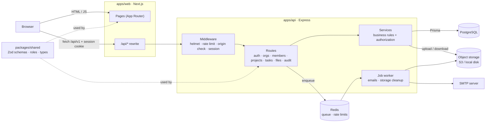
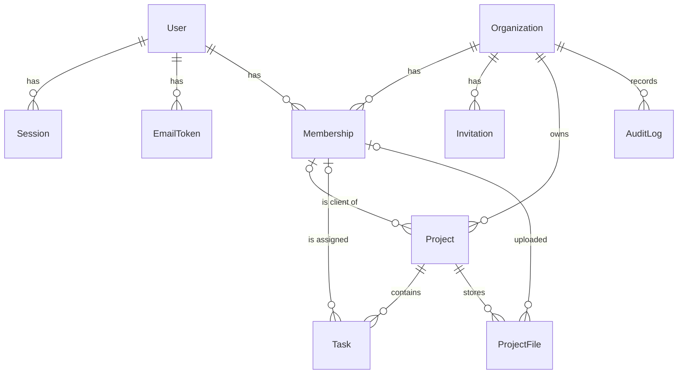

# Architecture

ClientHub is a monorepo with two apps and one shared package.



## Request flow

1. The browser only talks to the Next.js origin. Requests to `/api/*` are proxied to the
   Express API, so the session cookie is first-party and no CORS configuration is needed.
2. The API runs every request through the same middleware chain:
   `helmet` (security headers) → rate limiter → origin check (CSRF) → session loader.
3. Routes under `/orgs/:orgId` also require a session and a membership in that organization.
   Users who are not members get a `404`, so organization IDs cannot be probed.
4. Each handler checks the permission it needs with `authorize(req, "projects:create")`,
   validates the body with the shared Zod schema, and calls a service.
5. Services apply the business rules. Every project query goes through
   `visibleProjectsWhere()`, which scopes it to the organization and, for clients,
   to their own projects. Tasks and files are always reached through their project.
   This is the main protection against IDOR.
6. Important changes are written to the audit log, and slow side effects (emails, deleting
   file bytes) are put on the job queue so the response does not wait for them.

## Infrastructure adapters

The API depends on small interfaces, chosen from the environment at startup
(`apps/api/src/services.ts`). Local development needs only PostgreSQL.

| Concern         | Interface                  | Production                    | Without configuration     |
| --------------- | -------------------------- | ----------------------------- | ------------------------- |
| Email           | `Mailer`                   | SMTP (`SMTP_URL`)             | Printed to the API log    |
| Background jobs | `JobQueue`                 | BullMQ on Redis (`REDIS_URL`) | Run in-process            |
| File storage    | `Storage`                  | S3-compatible (`S3_BUCKET`)   | Local disk (`UPLOAD_DIR`) |
| Rate limits     | `express-rate-limit` store | Redis (shared by instances)   | In memory                 |

Tests use in-memory versions (`MemoryMailer`, inline queue, a temp directory), and CI also runs
the Redis and S3 adapters against real services. See [ADR 0005](adr/0005-background-jobs-with-bullmq.md)
and [ADR 0006](adr/0006-file-uploads.md).

## Folder structure

```text
apps/api/src
├── app.ts              → builds the Express app (dependencies are injected for tests)
├── server.ts           → entry point: config, logger, Prisma, services, graceful shutdown
├── services.ts         → picks the mailer, queue and storage adapters from the config
├── config.ts           → environment variables validated with Zod (fails fast)
├── lib/                → errors, passwords, tokens, logger, Prisma, mailer, queue, storage
├── middleware/         → auth, membership, origin check, rate limit, error handler
└── modules/<feature>/  → <feature>.routes.ts (HTTP) + <feature>.service.ts (logic)
                          auth · organizations · members · projects · tasks · files · audit · notifications

apps/web/src
├── app/                → routes (App Router): (auth), (app), invite
├── components/         → small UI kit, project files panel
└── lib/                → API client, TanStack Query hooks, form helpers

packages/shared/src
├── roles.ts            → roles, permission matrix, member-management rules
├── schemas.ts          → Zod schemas used by both the API and the forms
└── types.ts            → API response types
```

## Data model



- A user can belong to many organizations, with one role in each (`OWNER`, `ADMIN`, `MEMBER`, `CLIENT`).
- A project can have one client (a `CLIENT` member). Clients only see their own projects.
- Session, invitation, email-verification and password-reset tokens are stored as SHA-256
  hashes, never in plain text.
- File bytes live in object storage; `ProjectFile` keeps the metadata and a random storage key.

## Roles and permissions

| Permission                       | Owner |      Admin      | Member | Client |
| -------------------------------- | :---: | :-------------: | :----: | :----: |
| See all projects                 |  ✅   |       ✅        |   ✅   |   —    |
| See own client projects          |  ✅   |       ✅        |   ✅   |   ✅   |
| Create / edit / delete projects  |  ✅   |       ✅        |   —    |   —    |
| Create / edit / delete tasks     |  ✅   |       ✅        |   ✅   |   —    |
| Upload files to visible projects |  ✅   |       ✅        |   ✅   |   ✅   |
| Delete files                     |  ✅   |       ✅        |  own   |  own   |
| See members                      |  ✅   |       ✅        |   ✅   |   —    |
| Invite / change / remove members |  ✅   | ✅ (not owners) |   —    |   —    |
| See the audit log                |  ✅   |       ✅        |   —    |   —    |

The matrix lives in [`packages/shared/src/roles.ts`](../packages/shared/src/roles.ts) and is
used by the API (enforcement) and the web app (hiding actions).

## Decisions

Architecture Decision Records are in [`docs/adr`](adr/).
