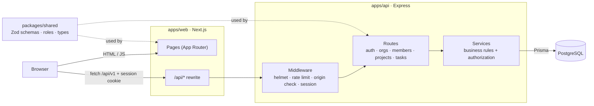
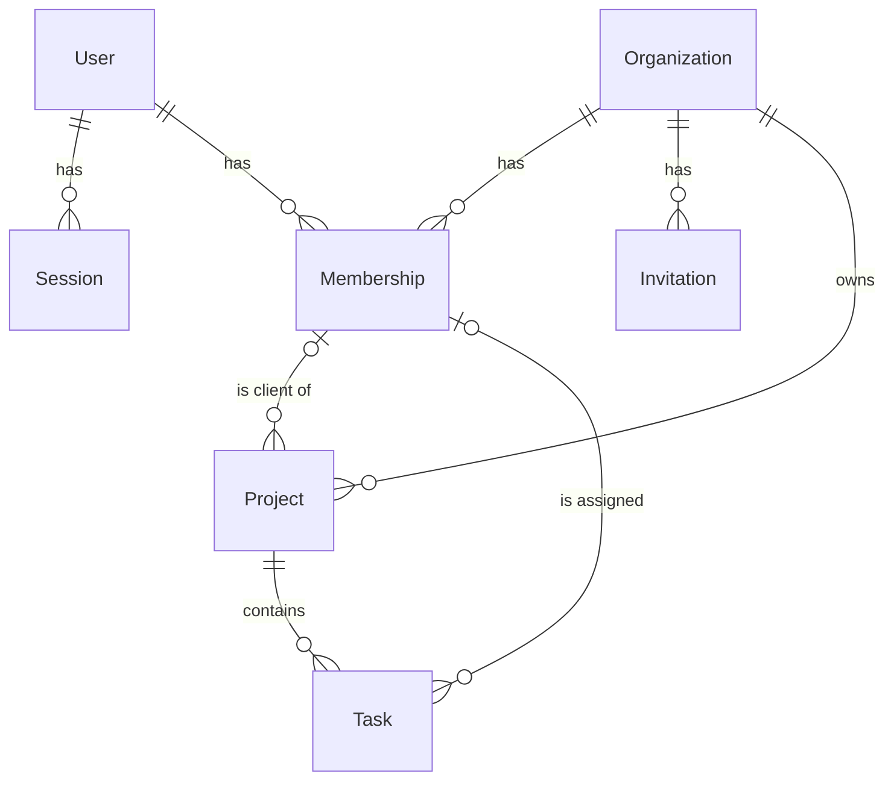

# Architecture

ClientHub is a monorepo with two apps and one shared package.



## Request flow

1. The browser only talks to the Next.js origin. Requests to `/api/*` are proxied to the
   Express API, so the session cookie is first-party and no CORS configuration is needed.
2. The API runs every request through the same middleware chain:
   `helmet` (security headers) → rate limiter → origin check (CSRF) → session loader.
3. Routes under `/orgs/:orgId` also require a session and a membership in that organization.
   Users who are not members get a `404`, so organization IDs cannot be probed.
4. Each handler checks the permission it needs with `authorize(req, "projects:create")`,
   validates the body with the shared Zod schema, and calls a service.
5. Services apply the business rules. Every project query goes through
   `visibleProjectsWhere()`, which scopes it to the organization and, for clients,
   to their own projects. This is the main protection against IDOR.

## Folder structure

```text
apps/api/src
├── app.ts              → builds the Express app (dependencies are injected for tests)
├── server.ts           → entry point: config, logger, Prisma, graceful shutdown
├── config.ts           → environment variables validated with Zod (fails fast)
├── lib/                → errors, password hashing, tokens, logger, Prisma client
├── middleware/         → auth, membership, origin check, rate limit, error handler
└── modules/<feature>/  → <feature>.routes.ts (HTTP) + <feature>.service.ts (logic)

apps/web/src
├── app/                → routes (App Router): (auth), (app), invite
├── components/         → small UI kit
└── lib/                → API client, TanStack Query hooks, form helpers

packages/shared/src
├── roles.ts            → roles, permission matrix, member-management rules
├── schemas.ts          → Zod schemas used by both the API and the forms
└── types.ts            → API response types
```

## Data model



- A user can belong to many organizations, with one role in each (`OWNER`, `ADMIN`, `MEMBER`, `CLIENT`).
- A project can have one client (a `CLIENT` member). Clients only see their own projects.
- Session and invitation tokens are stored as SHA-256 hashes, never in plain text.

## Roles and permissions

| Permission                       | Owner |      Admin      | Member | Client |
| -------------------------------- | :---: | :-------------: | :----: | :----: |
| See all projects                 |  ✅   |       ✅        |   ✅   |   —    |
| See own client projects          |  ✅   |       ✅        |   ✅   |   ✅   |
| Create / edit / delete projects  |  ✅   |       ✅        |   —    |   —    |
| Create / edit / delete tasks     |  ✅   |       ✅        |   ✅   |   —    |
| See members                      |  ✅   |       ✅        |   ✅   |   —    |
| Invite / change / remove members |  ✅   | ✅ (not owners) |   —    |   —    |

The matrix lives in [`packages/shared/src/roles.ts`](../packages/shared/src/roles.ts) and is
used by the API (enforcement) and the web app (hiding actions).

## Decisions

Architecture Decision Records are in [`docs/adr`](adr/).
